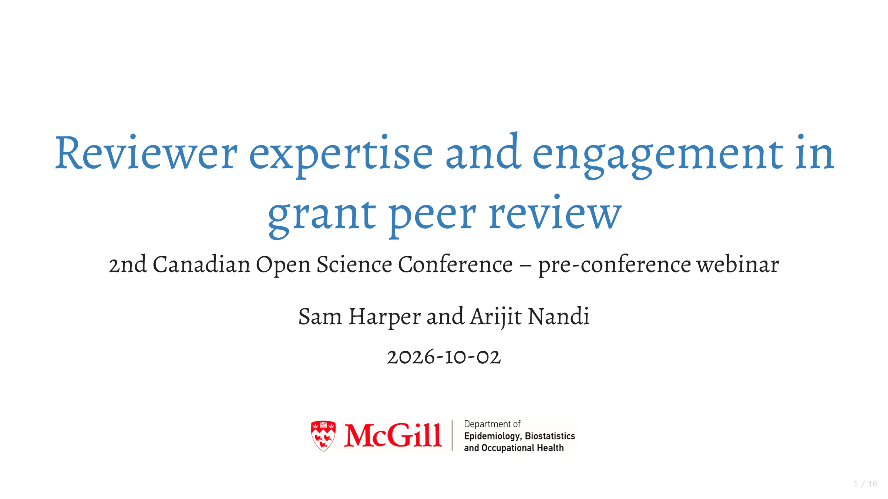

Presentation (with Arijit Nandi) given at the pre-conference webinar for the 2nd Canadian Open Science Conference, Oct 2, 2026.

Below you can access the slides.

:::columns
::: {.column width="45%"}

 [HTML version](ror-cosc-2026.html) 

{width=50%}
:::

::: {.column width="45%"}

 [PDF version](ror-cosc-2026.pdf) 

{width=30%}
:::

:::
